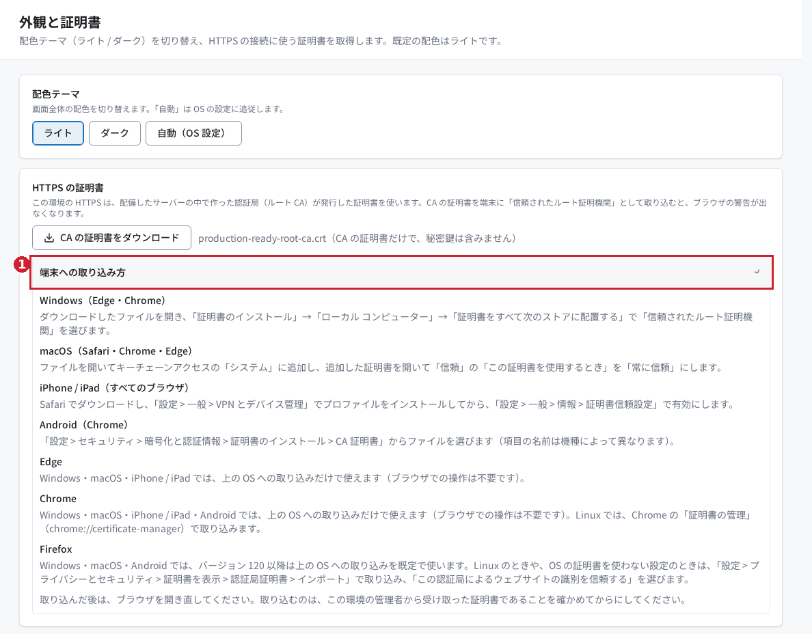

# Production Ready RAG の外観と証明書を使ってみる

## はじめに

「外観と証明書」では、HTTPS の接続に使う CA 証明書を取得できます。CA（認証局）とは、接続先の証明書を発行する仕組みです。

この記事では、証明書のダウンロードと端末への取り込み案内を確認します。画面の配色はライトの 1 種類だけで、配色を選ぶ操作はありません（#17 で配色テーマの選択を廃止しました）。

> 2026年10月28日に実画面で確認しました（配色テーマの選択を廃止する前の画面です。図1・図4には、現在は表示されない配色のボタンが写っています）。証明書を端末に取り込む操作と、取り込み後にブラウザーの警告が消えることは未確認です。

## 前提条件

- RAG にログインでき、「システム設定」の「外観と証明書」を開く権限があること。表示されない場合は管理者に確認してください。
- 証明書を取得する場合は、その環境が CA 証明書を配布していること。
- 端末に証明書を取り込む場合は、管理者から配布元が正しいことを確認でき、端末の証明書設定を変更する許可があること。

この画面の操作は、ほかの利用者の画面や、サーバーの認証設定を変更するものではありません。

## 今回使うサンプル

[練習用チェックシート.txt](samples/練習用チェックシート.txt) は、確認する順序を記した日本語の合成資料です。架空の練習用として新しく作成しており、実際の利用者や業務データは含みません。

この機能にはファイルのアップロードや読み込みはありません。サンプルは手元で読む補助資料です。

証明書は接続先の環境から取得する必要があります。合成の証明書で信頼設定を再現することはできないため、サンプルにも記事にも実環境の証明書は同梱していません。

## 操作手順

### 1. 「外観と証明書」を開く

左のナビゲーションで「システム設定」を展開し、「外観と証明書」を選びます。見出し「外観と証明書」と「HTTPS の証明書」が表示されれば、この画面を開けています。

図1：②証明書のダウンロード、③取り込み案内。確認環境ではダウンロードボタンが表示されました。①の配色の選択は #17 で廃止し、現在の画面には表示されません。

### 2. CA の証明書をダウンロードする

「HTTPS の証明書」で「CA の証明書をダウンロード」を押します。`production-ready-root-ca.crt` が保存されれば、取得できています。`.crt` は証明書ファイルの拡張子です。保存先はブラウザーの設定に従います。

今回の実操作では、ファイルをダウンロードし、証明書として読み取れることまで確認しました。配布ファイルに秘密鍵は含まれない仕様です。

### 3. 「端末への取り込み方」を開く

「端末への取り込み方」を押し、利用する端末・ブラウザーの案内を確認します。Windows、macOS、iPhone / iPad、Android、Edge、Chrome、Firefox の説明が表示されます。

図3：①を開くと、利用する端末に合わせた案内を読めます。画面の内容は確認済みですが、各端末への実際の取り込みは未実施です。

取り込む前に、証明書が接続先環境の管理者から提供されたものか確認します。取り込み後は、画面の案内に従ってブラウザーを開き直し、対象環境を開いて警告の有無を確認してください。組織で管理された端末では、管理者による対応が必要になる場合があります。

## 結果の確認

| 操作 | 確認すること |
|---|---|
| 証明書の取得 | `production-ready-root-ca.crt` が保存される |
| 案内の表示 | 「端末への取り込み方」の下に端末別の説明が出る |

図4：幅375pxの表示。②証明書のダウンロードも操作できます。横方向のはみ出しがないことを確認しました。①の配色のボタンは #17 で廃止しました。

## よくあるつまずきと対処

### 証明書のダウンロードボタンがない

実装では、証明書を配布していない、または取得可否を確認できない場合に「この環境では HTTPS の自己署名の証明書を使っていません。」という案内を表示します。配備状況や接続を管理者に確認してください。今回の環境ではボタンが表示されており、この案内の実画面は撮影していません。

### 証明書を取得したのにブラウザーの警告が消えない

ダウンロードと端末の信頼設定への取り込みは別の操作です。画面の「端末への取り込み方」を確認してください。警告が消えることは今回未確認のため、取り込み先や証明書の対応関係は環境の管理者と確認してください。

## まとめ

「外観と証明書」で、環境の CA 証明書を取得して取り込み案内を開けます。証明書の信頼設定は、正しい配布元を確認してから進めてください。

実操作の範囲と未確認事項は[検証記録](検証記録.md)にまとめています。
