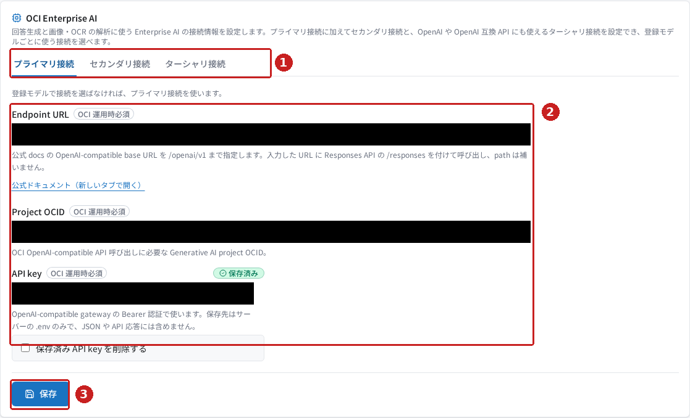
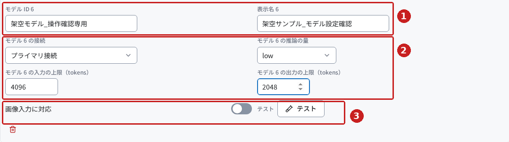
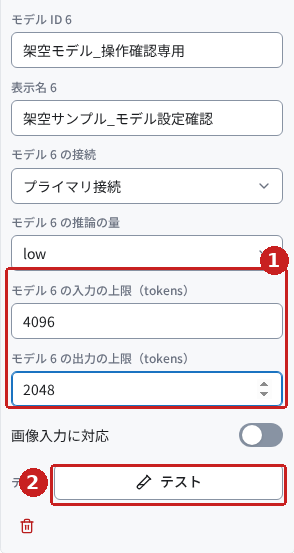
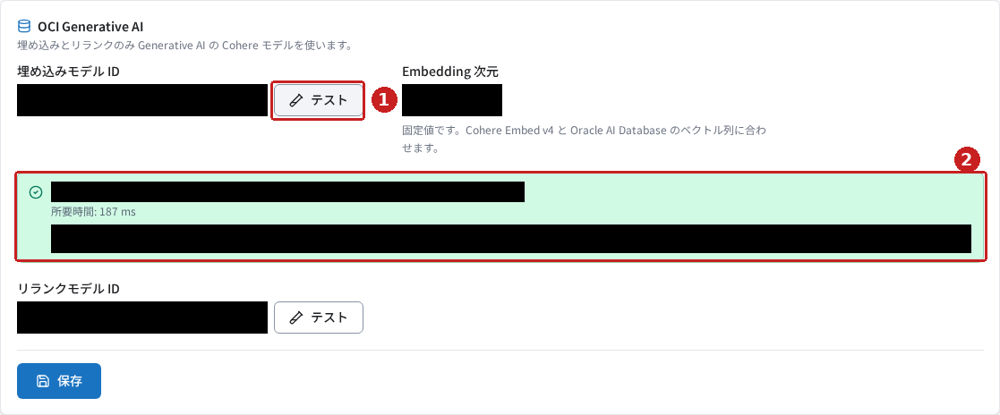

# Production Ready RAG のモデル設定を使ってみる

## はじめに

RAG の「モデル設定」では、回答生成・画像の読み取り・検索に使う AI モデルを設定します。この記事では **システム設定 → モデル** を開き、接続情報、登録モデル、用途ごとの既定モデル、埋め込み・再ランクの確認方法を紹介します。

> 2026年10月28日に実画面を確認しました。日本語の架空モデルの追加と入力は**未保存の状態**で確認し、保存済みの埋め込みモデルでは実サービスへのテスト成功を確認しました。接続情報の変更・保存、モデルの登録確定・削除確定、回答生成・画像対応・再ランクのテストは実施していません。該当箇所は実装に基づく説明として区別しています。
>
> 画像は実画面のキャプチャです。設定値と診断情報を黒塗りにし、操作対象に赤枠と番号を付けています。
>
> **画面の変更（#45 / #51）**: 撮影の後、埋め込み・再ランクのモデルは独立した区画をやめて「登録モデル」に種類（テキスト・埋め込み・再ランク）を選んで登録する形になり（#45）、接続の区画の見出しは「OCI Enterprise AI」から「モデルの API」、欄名は「Project ID」から「Project ID」になりました（#51）。本文は今の画面に合わせています。図1と図4は変更の前の画面です（撮り直しは別の Issue）。

## 前提条件

- RAG にログインし、「システム設定 → モデル」を開ける権限があること（`menu.settings_model`）。アクセス先は環境管理者から案内された `<環境URL>/rag/` です。
- 接続先の情報と利用できるモデル ID を、環境管理者が確認していること。
- 埋め込み・再ランクのモデルも、登録モデルで選んだ接続（モデルの API）で呼び出します。テストには、その接続の API key と、対象のモデルを使う権限が必要です。
- 保存の練習は、稼働中の設定を上書きしない独立した検証環境で行ってください。

この画面は RAG・NL2SQL・Agent で共通です。モデル設定の変更は他の製品にも影響するため、既存モデルの削除や API key の削除は、影響を確認してから行います。

**モデル ID** は呼び出す AI モデルを指定する値です。**Endpoint URL** は API の接続先、**API key** は接続を許可する認証情報です。**Project ID** は、接続先が求める場合だけ `OpenAI-Project` ヘッダーで送る ID です（任意）。

## 今回使うサンプル

[架空モデル入力例.json](samples/架空モデル入力例.json)には、画面への手入力に使った日本語の合成データをまとめています。[サンプルの説明](samples/README.md)も参照してください。

| 項目 | 今回の入力例 |
|---|---|
| モデル ID | `架空モデル_操作確認専用` |
| 表示名 | `架空サンプル_モデル設定確認` |
| 接続 | プライマリ接続 |
| 推論の量 | `low` |
| 入力の上限（tokens） | `4096` |
| 出力の上限（tokens） | `2048` |
| 画像入力に対応 | オフ |

**架空のモデル ID で AI の応答は取得できません。** このサンプルは、未保存の入力と表示を学ぶためのものです。JSON は画面にアップロードするファイルではありません。この画面にはモデル一覧のファイル取込機能はなく、手入力で設定します。

## 操作手順

### 1. 「モデル設定」を開く

1. RAG にログインします。
2. 左のナビゲーションで **システム設定 → モデル** を選びます。
3. 画面の見出しが **モデル設定** であることを確認します。

画面には **モデルの API**（接続）と **登録モデル**（既定のモデルを含む）の2つの区画があります。各区画の末尾にある **保存** は、それぞれ別の保存操作です。

### 2. モデルの API の接続情報を確認する

**モデルの API** は、回答生成・画像の読み取り・埋め込み・再ランクのモデルを呼び出す OpenAI 互換の API（DeepSeek・Aliyun 百煉など）の接続です。

*図1：①で接続を切り替え、②で接続先と認証情報を確認します。③はこの区画の保存です。今回は保存していません。撮影時の見出しは「OCI Enterprise AI」、欄名は「Project ID」でした。*

| 項目 | 確認すること |
|---|---|
| プライマリ接続 | 基本となる接続。登録モデルの接続が未指定の場合にも使う |
| セカンダリ接続 | 別の接続先や Project を使う場合の追加接続 |
| ターシャリ接続 | 3つ目の接続。OpenAI や OpenAI 互換 API のモデルに使う |
| Endpoint URL | 環境管理者から案内された `<Endpoint URL>`。`https://api.deepseek.com/v1`・`https://dashscope.aliyuncs.com/compatible-mode/v1` のように base URL をパスまで含めて指定する |
| Project ID | 接続先が求める場合だけ、環境管理者から案内された `<Project ID>` を入力する。不要なら空のままにする |
| API key | 初期設定・変更時のみ `<API_KEY>` を入力する。「保存済み」は設定があることを示す |

新しく接続を設定する場合は、対象のタブを開き、必要に応じて **セカンダリ接続を設定** または **ターシャリ接続を設定** を押します。

> 新しい接続の保存は実装に基づく説明です。必要な項目を入力し、この区画の **保存** を押します。成功時は接続設定を保存したことが通知されます。追加した接続を登録モデルで使う場合は、先に接続を保存します。今回は接続の追加・変更・保存を実行していません。

URL の末尾に API のパスを自動補完する仕組みはありません。`/responses` を付けて呼び出すため、案内された base URL を正確に指定します。既存の API key を変える必要がなければ、新しい値を入力したり、**保存済み API key を削除する** をオンにしたりしないでください。

### 3. 「登録モデル」に合成データを入力してみる

この手順は、保存せずに入力欄を確認する練習です。

1. **登録モデル** の **追加** を押します。
2. 末尾に追加された行へ、サンプルのモデル ID と表示名を入力します。
3. 接続を **プライマリ接続**、推論の量を **low** にします。
4. 入力の上限に **4096**、出力の上限に **2048** を入力します。
5. **画像入力に対応** はオフのままにします。
6. 保存は押さず、入力欄と表示が図2のようになったことを確認します。

*図2：①はモデル ID と表示名、②は接続とモデルのパラメーター、③は画像入力とテストです。実際の既存モデルが5行あったため、この例では6行目に追加しています。行番号は環境によって変わります。*

**トークン（tokens）**は、モデルが文字列を扱う際の単位です。日本語の文字数と同じではありません。**推論の量**は対応モデルへ推論の程度を指定する設定で、`none（送らない）` は指定を送らずモデル側の既定を使います。

| 項目 | 選び方・制約（実装を確認） |
|---|---|
| モデル ID | 利用可能な ID を正確に入力する。同じ ID の重複登録はできない |
| 表示名 | 画面で区別しやすい名前を付ける |
| 接続 | そのモデルを使える保存済みの接続を選ぶ |
| 推論の量 | `none（送らない）`、`low`、`medium`、`high`。対応はモデルごとに異なる |
| 入力の上限（tokens） | 4096〜2000000 の整数。入力と出力を合わせたコンテキスト長の予算であり、モデル自体の上限を増やす設定ではない |
| 出力の上限（tokens） | 1〜2000000 の整数で、入力の上限以下。モデルが対応する出力上限も超えないようにする |
| 画像入力に対応 | 実際に画像入力を受け付けるモデルだけオンにする |

追加行は未保存です。練習後はページを再読み込みし、離脱の確認が出た場合は検証用の入力を破棄します。今回は再読み込み後に架空の入力が残っていないことを確認しました。

*図3：幅375pxでは項目が縦に並びます。①の上限値と②のテストを、上下にスクロールしながら確認できます。*

### 4. 用途ごとの「既定のモデル」を選ぶ

> この手順は実装に基づく説明です。今回は既定モデルの変更・保存は実施していません。

実際のモデルを登録する場合は、一覧の下にある **既定のモデル** も確認します。

1. **既定のテキストモデル** に、回答生成などで使う登録モデルを選びます。
2. **既定の画像対応モデル** に、画像入力に対応した登録モデルを選びます。
3. 必要に応じて **既定の判定モデル** を選びます。品質評価の判定に使うモデルです。
4. **登録モデル** の末尾にある **保存** を押します。
5. 成功時は **登録モデルを保存しました。** と通知されます。再表示して登録内容と既定モデルを確認します。

テキストと画像対応の既定モデルは必須です。画像対応の選択肢には、**画像入力に対応** がオンのモデルだけが表示されます。品質評価でモデルを比較するときは、判定モデルを別のモデルに固定することが画面で案内されています。

### 5. 対象モデルの「テスト」を使う

**テスト**は、実際のサービスを呼び出して応答を確かめる操作です。モデル ID が空の行では実行できません。

登録モデルの各行の **テスト** は、その行で選んだ接続と、画面で入力している未保存の設定も使います。先に保存しなくても入力中のモデル設定を確かめられます。テストの成功は設定の保存を意味しません。

回答生成では短い接続確認の文章、画像対応モデルでは白地に赤い正方形のテスト画像をシステムが用意して呼び出します。これらの登録モデルのテストは今回は未実施です。架空モデルの行では実行せず、実際に利用できるモデルで確認してください。

### 6. 埋め込み・再ランクを確認する

**埋め込み（Embedding）**は文章を検索用の数値の並びに変換する処理、**再ランク（Rerank）**は検索候補の関連度を判定して並べ直す処理です。どちらのモデルも **登録モデル** に、種類を **埋め込み** または **再ランク** にして登録します（#45）。

1. **登録モデル** で、種類が **埋め込み** の行を確認します。
2. その行の **テスト** を押します。
3. 結果欄に **埋め込みモデル「〈対象モデル〉」で 1024 次元のベクトルを取得しました。** のように表示されることを確認します（次元数はモデルによります）。
4. **既定のモデル** の **既定の埋め込みモデル** と **既定の再ランクモデル** に、使うモデルが選ばれていることを確認します。

*図4：①が埋め込みのテスト、②が今回実際に成功した結果欄です。撮影したのは、埋め込み・再ランクが独立した区画だったときの画面です。今は登録モデルの行の「テスト」で同じ確認をします。設定値・対象モデル名を含む結果文・詳細は非公開にしています。*

今回は保存済みのモデルを変更せず、この埋め込みテストの成功を確認しました。テストはシステムが用意した日本語の接続確認用短文を送信するため、既存の文書を選んだりアップロードしたりする必要はありません。

再ランクは、種類が **再ランク** の行の **テスト** で別途確認します。成功時は **再ランクモデル「〈対象モデル〉」で文書を並べ替えました** のように表示されます。こちらは実装を確認した説明で、今回は実行していません。

設定を変更する場合は、**登録モデル** の末尾の **保存** を押します。この保存操作は未実施です。

## 結果の確認

| 確認すること | 成功の目印 | 今回の確認 |
|---|---|---|
| 画面を開く | 「モデル設定」と2つの設定区画（モデルの API・登録モデル）が表示される | 実画面で確認 |
| 合成モデルの入力 | 追加行にサンプルの値が表示される | desktop・375pxで確認。未保存 |
| 検証用入力の破棄 | 再読み込み後、架空のモデル行が残っていない | 実画面で確認 |
| 埋め込みテスト | 1024次元ベクトル取得の成功文 | 実サービスの応答で確認 |
| 接続・登録モデルの保存 | 対応する保存通知と再表示後の設定 | 未実施。保存処理・通知を実装照合 |
| 回答生成・画像対応・再ランクのテスト | 対象ごとの応答取得メッセージ | 未実施。実装照合 |

埋め込みテストだけで、文書取込・回答生成・画像解析がすべて動くと判断することはできません。利用する処理ごとに確認してください。

## よくあるつまずきと対処

以下は実装と画面の説明を根拠にした注意点です。障害や入力エラーは今回再現していません。

| 状況 | 確認・対処 |
|---|---|
| 追加した接続を選んだモデルが保存できない | 上の「モデルの API」の区画で、先に接続を保存する |
| 画像対応の既定モデルに候補がない | 対応モデルで「画像入力に対応」をオンにしてから選び直す |
| 上限値で保存できない | 整数であること、範囲内であること、出力が入力の上限以下であることを確認する |
| テストが成功したのに次回表示で設定が戻る | テストと保存は別の操作。確定する区画の「保存」が必要 |
| 保存時に他の画面で更新されたと案内される | 「最新の設定を読み込む」で最新設定を取得する。未保存入力は破棄されるので、再入力が必要な内容を確認する |
| API key が「保存済み」なのに呼び出せない | 設定があることと認証成功は別。接続先・Project・モデル ID・権限を管理者と確認し、対象モデルをテストする |
| 失敗結果に「詳細」が表示される | 実環境の識別情報が含まれる場合があるため、そのまま外部に共有しない |

## まとめ

「モデル設定」は、接続情報、登録モデル（テキスト・埋め込み・再ランク）と用途ごとの既定値を設定する画面です。**接続を準備 → 登録モデルを入力 → 用途ごとの既定を選択 → 対象モデルをテスト → 各区画で保存**の順で確認すると、設定と接続確認の違いを整理できます。

今回の合成サンプルは入力練習用です。実際の運用には、環境管理者が案内する接続情報とモデル ID を使ってください。確認範囲と未実施事項は[検証記録](検証記録.md)に記載しています。
